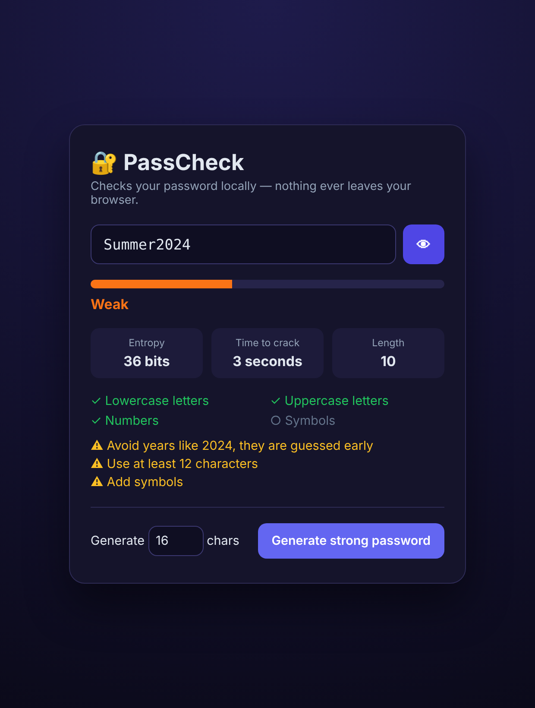
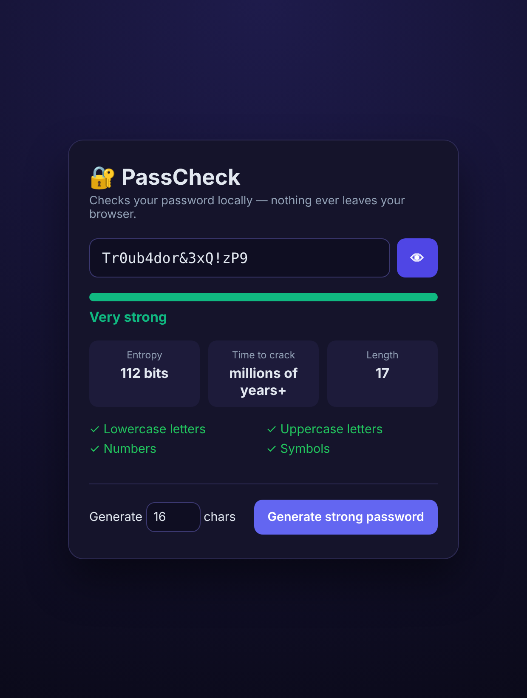

# 🔐 PassCheck: Password Strength Analyzer

A fast, private password strength checker that runs **entirely in your browser**. Nothing is sent anywhere.
Plain HTML, CSS and JavaScript, with no frameworks and no build step.

| Weak password | Strong password |
|---|---|
|  |  |

## Features

- Live strength meter (Very weak → Very strong)
- **Entropy** in bits and an estimated **time to crack**
- Checks for lowercase, uppercase, numbers and symbols
- Detects common passwords, repeated characters (`aaa`), sequences (`123`, `abc`) and years (`2024`)
- Gives specific tips to improve the password
- **Secure password generator** using `crypto.getRandomValues`
- Show/hide toggle

## Run it

Open `index.html` in your browser. That's it.

Run the tests (Node.js):
```bash
node test.js
```

## How it works

1. **Character pool:** count which character types are used (26 lowercase + 26 uppercase + 10 digits + 33 symbols).
2. **Entropy:** `bits = length × log2(pool size)`. Each extra bit doubles the number of guesses needed.
3. **Penalties:** common words, repeats, sequences and years cut the score, because attackers try those first.
4. **Crack time:** `2^bits ÷ 2 ÷ 10 billion guesses per second` (an average attack by a fast GPU rig).

## Project structure

```
index.html    # UI
style.css     # styling
strength.js   # analysis + generator (no DOM, so it can be tested in Node)
app.js        # connects the logic to the UI
test.js       # 10 tests
```

## Live demo with GitHub Pages

Settings → Pages → Source: `main` branch, root folder → your app goes live at
`https://<username>.github.io/passcheck/`

## License

MIT
